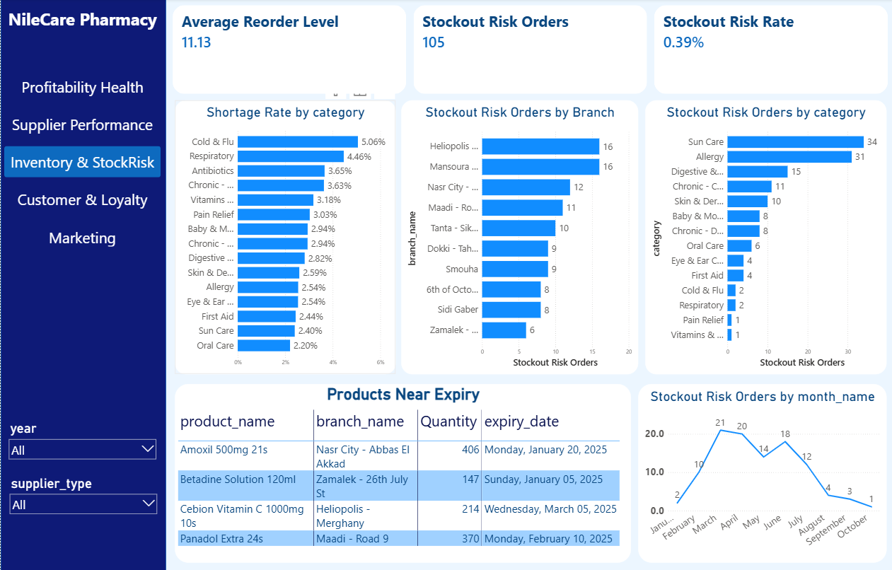

# NileCare Pharmacy Group: End-to-End Data Analytics Project

An end-to-end analytics project for a fictional Egyptian pharmacy chain: four raw source files, a SQL Server data warehouse (Galaxy Schema), and a five-page Power BI dashboard, with a written management report on profitability, suppliers, inventory, customers and marketing.

> **Note:** all source data is synthetic. It was generated to include realistic business effects, such as the EGP devaluation in 2024 and Ramadan/Eid seasonality.


**Management report:** [NileCare_Business_Performance_Report.pdf](NileCare_Business_Performance_Report.pdf)

---

## Table of Contents

- [Business Problem](#business-problem)
- [Key Findings](#key-findings)
- [Architecture](#architecture)
- [Data Model](#data-model)
- [Dashboard Pages](#dashboard-pages)
- [Methodology Notes](#methodology-notes)
- [Tech Stack](#tech-stack)
- [Repository Structure](#repository-structure)
- [How to Reproduce](#how-to-reproduce)
- [Limitations](#limitations)
- [Future Work](#future-work)
- [Author](#author)

---

## Business Problem

NileCare's revenue is stable, but profit is shrinking. Management needs to know:

1. Is the company actually profitable, and where is margin being lost?
2. Which suppliers create cost or delivery risk?
3. Is stock keeping up with demand, and where is the stockout and expiry risk?
4. Which customers are we losing, and who can we win back?
5. Does marketing spend pay back, and which channels deserve budget?

## Key Findings

| Area | Finding |
|---|---|
| Profitability | Revenue is 15.97M EGP with an 18.6% gross margin. Monthly gross profit has been negative since May 2024. |
| Suppliers | Multinational suppliers carry about 94% of procurement spend at roughly 16% margin, against about 30% for Local suppliers. |
| Lead time | Multinational lead time is 21.86 days against 5.04 days for Local. |
| Inventory | 4.08% of purchase orders carry stockout risk, concentrated in Sun Care and Allergy between February and June. |
| Customers | Gold and Platinum are about 5% of buyers but about 36% of lifetime spend. 731 chronic patients have lapsed. |
| Marketing | ROAS is 1.94. TV takes about 47% of spend with near-zero return. Push Notification returns 33x. |

**Central story:** Sun Care, Allergy and imported essentials (insulin, infant formula) combine weak margin, high stockout risk and heavy promotion. All three trace back to import cost and sourcing after the March 2024 EGP float.

## Architecture

```
RAW CSV FILES (POS, ERP, CRM, Marketing)
        |
        v
STAGING (schema: staging)
  stg_pos | stg_erp | stg_crm | stg_marketing
  all columns NVARCHAR, no keys, no transformation
        |
        v
DATA WAREHOUSE (schema: dwh)
  Galaxy Schema: 3 fact tables + conformed dimensions
        |
        v
POWER BI (Import mode)
  relationships + DAX measures + 5 report pages
```

**Why a Galaxy Schema:** the project covers three business processes with different grains (a sales line item, a purchase-order line, a daily campaign row). Three fact tables share conformed dimensions rather than forcing everything into one star.

## Data Model

### Fact tables

| Table | Grain | Rows |
|---|---|---|
| `fact_sales` | one sales line item | 151,326 |
| `fact_procurement` | one purchase-order line | 26,634 (+4 manually added batches) |
| `fact_marketing` | one campaign per day | 2,073 |

### Dimension tables

| Table | Description | Rows |
|---|---|---|
| `dim_date` | built in SQL, 2023-01-01 to 2024-12-31, with Egypt weekend, Ramadan and Eid flags | 731 |
| `dim_branch` | branches and regions | 10 |
| `dim_product` | products, category, storage and shelf life | 87 |
| `dim_supplier` | suppliers, with Local or Multinational type | 24 |
| `dim_campaign` | 17 campaigns plus a `NONE` row for non-promotional sales | 18 |
| `dim_customer` | 6,000 customers plus a `WALKIN` row for unregistered buyers | 6,001 |

Staging row counts match the source files exactly: 151,326 / 26,634 / 6,000 / 2,073.

## Dashboard Pages

| Page | Question it answers |
|---|---|
| **Profitability Health** | Is the company profitable, and where is margin lost? |
| **Supplier Performance** | Which suppliers serve us well, and which cause delay or cost exposure? |
| **Inventory & Stock Risk** | Is stock keeping up with demand, and where is the risk concentrated? |
| **Customer & Loyalty** | How many valuable customers are we losing, where, and who can we win back? |
| **Marketing Performance** | Does marketing spend pay back, and which channels and categories deserve budget? |

Screenshots (the full five pages are in the `.pbix` file):

**Profitability Health**


**Inventory & Stock Risk**



### DAX measures (by domain)

- **Sales:** Total Revenue, Total Quantity Sold, Total Transactions, Average Basket Value, Discount Rate, Promotion Sales %, Prescription Sales %
- **Profitability:** Total COGS, Gross Profit, Gross Margin %, Net Profit
- **Time intelligence:** Sales YoY %, MoM %, MTD, QTD, YTD, Rolling 3M
- **Seasonality:** Ramadan Sales %, Weekend Sales %
- **Customers:** Active Customers, Customer Retention Rate, At-Risk Customers, Gold & Platinum Customers, Customer Revenue Contribution %
- **Procurement:** Average Lead Time, On-Time Delivery Rate, Shortage Rate, Fulfillment Rate, Stockout Risk Rate
- **Marketing:** Total Marketing Spend, ROAS, CTR, CPC, CPA, Conversion Rate

## Methodology Notes

**Cost of goods sold (`fact_sales.cogs_egp`)**

1. A flat average cost per product was rejected because it ignores timing.
2. COGS now uses a point-in-time lookup: the last known purchase cost on or before the sale date (`CROSS APPLY` + `TOP 1 ... ORDER BY order_date_key DESC`).
3. After the 2024 devaluation, a few imported products (Lantus Insulin Pen, Nan Formula, Nestogen Formula) had cost above price.
4. A floor caps each sale line at a 5% loss. It affects 1,967 of 151,326 rows (1.3%).

**Power BI relationship fix:** adding `dim_product[supplier_key] -> dim_supplier[supplier_key]` created an ambiguous path with `fact_procurement`. The direct `fact_procurement -> dim_supplier` relationship was set to inactive, so the active path is `fact_procurement -> dim_product -> dim_supplier`. This lets `fact_sales` be filtered by supplier type.

**Customer segments:** measured against the last date in the data (2024-12-31), not today's date. At-Risk means last purchase 90 to 180 days ago, and Lost means more than 180 days. Retention is calculated on customers who have purchased at least once.

**Near-expiry view:** a simplified stock estimate (total received minus total sold), not true FIFO or FEFO. Four purchase batches were added manually so the view has realistic content.

**Design rule:** a dimension already shown as a chart on a page does not get a duplicate slicer. Cross-filtering by clicking the chart serves the same purpose.

## Tech Stack

- **Database:** SQL Server (T-SQL)
- **BI:** Power BI Desktop, DAX
- **Data modeling:** Galaxy Schema, surrogate keys, conformed dimensions
- **Source data:** CSV files (POS, ERP, CRM, Marketing)

## Repository Structure

```
nilecare-pharmacy-analytics/
├── raw_data.rar                                # the four source CSV files (POS, ERP, CRM, Marketing)
├── nilecare_dwh.sql                            # staging, dimensions, facts and COGS logic
├── NileCarePharmacyGroup.pbix                  # Power BI dashboard (5 pages)
├── NileCare_Business_Performance_Report.pdf    # management report
├── image/
│   ├── profit.png
│   └── inventory.png
└── README.md
```

## How to Reproduce

1. Extract `raw_data.rar` (7-Zip or WinRAR) to get the four source CSV files.
2. In SQL Server, create a database and the `staging` and `dwh` schemas, then load each CSV into its staging table (all columns as `NVARCHAR`).
3. Run `nilecare_dwh.sql` to build the dimension tables, the fact tables, and `fact_sales.cogs_egp`.
4. Open `NileCarePharmacyGroup.pbix`, update the SQL Server connection, and refresh.
5. Mark `dim_date` as the Date Table so the time-intelligence measures work.

## Limitations

- All data is synthetic, so the findings illustrate the analysis approach and are not real company results.
- The 5% loss floor on COGS slightly understates the true 2024 loss on a few imported products.
- Marketing conversions and revenue were matched to POS rows where possible and may not represent full incremental impact.
- Retention is measured on purchasers only. The 687 registered customers who never bought are a separate conversion issue.

## Future Work

- **Churn prediction:** a classification model to rank customers by probability of lapsing, built from data before a cutoff date to avoid leakage.
- **Demand forecasting:** monthly sales by category and branch with Ramadan and Eid effects, to set better reorder levels.
- **Scenario simulation:** price changes for imported items and budget reallocation across marketing channels.
- **Customer segmentation:** RFM scoring with clustering.

## Author 

**Fawzy Mohamed shams Al_din**
[LinkedIn](https://www.linkedin.com/in/fawzy-shams-567a57357?utm_source=share_via&utm_content=profile&utm_medium=member_android) | [GitHub](https://github.com/fawzyshams) | fawzyshams009@gmail.com
